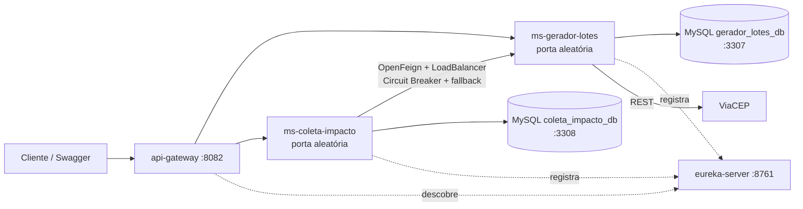

# ColetaAgendada - Microsserviços (Global Solution FIAP)

Solução de **economia circular / ESG** baseada em microsserviços: geradores (indústrias, comércios) cadastram **lotes de resíduos recicláveis**, coletores (cooperativas, recicladoras) **reservam** os lotes disponíveis na sua região e confirmam a coleta com um **código PIN**, gerando um **recibo de impacto ambiental** (CO2 evitado e pontos ESG).

## Integrantes

| Nome | RM |
|------|----|
| Clara de Fonte Almeida | RM554321 |
| Felipe Boveri | RM555055 |

## Arquitetura



| Módulo | Porta | Responsabilidade |
|--------|-------|------------------|
| `eureka-server` | 8761 | Service Discovery |
| `api-gateway` | 8082 | Ponto único de entrada (roteamento por service-id) |
| `ms-gerador-lotes` | aleatória | Geradores e lotes de resíduos (banco próprio) |
| `ms-coleta-impacto` | aleatória | Coletores, reservas/coletas e impacto ESG (banco próprio) |

**Tecnologias:** Java 25, Spring Boot 4.1.2, Spring Cloud 2025.1.4 (Eureka, Gateway, OpenFeign, LoadBalancer, Resilience4j), Spring Data JPA, Flyway, MySQL 8.4, Bean Validation, springdoc-openapi (Swagger), Docker / Docker Compose.

### Comunicação entre microsserviços

`ms-coleta-impacto` chama `ms-gerador-lotes` via **OpenFeign** usando apenas o nome do serviço no Eureka (sem URL fixa, balanceado pelo LoadBalancer):

- reservar coleta -> `PUT /api/v1/lotes/{protocolo}/reservar` (lote `DISPONIVEL` -> `RESERVADO`)
- cancelar coleta -> `PUT /api/v1/lotes/{protocolo}/liberar` (`RESERVADO` -> `DISPONIVEL`)
- baixa com PIN -> `PUT /api/v1/lotes/{protocolo}/coletar` (`RESERVADO` -> `COLETADO`)

Há **Circuit Breaker** (`geradorLotes`, Resilience4j) com **fallback** retornando `503 Service Unavailable` quando o `ms-gerador-lotes` está indisponível.

## Pré-requisitos

- JDK 25
- Docker Desktop (para os bancos MySQL)
- Acesso à internet (consulta ao ViaCEP na criação de lotes)

## Como executar

### Opção A - Tudo em Docker

```powershell
docker compose up -d --build
```

Sobe os 2 MySQL, Eureka, Gateway e os 2 microsserviços. Para derrubar: `docker compose down` (use `-v` para apagar os dados).

### Opção B - Bancos em Docker, serviços via Maven

1. Bancos de dados:
   ```powershell
   docker compose up -d mysql-gerador mysql-coleta
   ```
2. Em terminais separados, **nesta ordem**:
   ```powershell
   cd eureka-server;      .\mvnw.cmd spring-boot:run
   cd api-gateway;        .\mvnw.cmd spring-boot:run
   cd ms-gerador-lotes;   .\mvnw.cmd spring-boot:run
   cd ms-coleta-impacto;  .\mvnw.cmd spring-boot:run
   ```
   (Linux/macOS: `./mvnw spring-boot:run`)

As migrations **Flyway** criam o schema e populam os dados de exemplo automaticamente na primeira execução.

### Bancos de dados

| Banco | Host | Usuário / Senha | Microsserviço |
|-------|------|-----------------|---------------|
| `gerador_lotes_db` | `localhost:3307` | root / root | ms-gerador-lotes |
| `coleta_impacto_db` | `localhost:3308` | root / root | ms-coleta-impacto |

Variáveis de ambiente opcionais: `EUREKA_URL`, `DB_URL`, `DB_USER`, `DB_PASSWORD`.

## Portas aleatórias, Eureka e Swagger

Os microsserviços usam `server.port=0`. Para descobrir a porta de cada instância, abra o dashboard do Eureka: <http://localhost:8761> (ou veja o log de inicialização).

- Swagger UI: `http://localhost:<porta-da-instancia>/swagger-ui/index.html`
- OpenAPI JSON: `http://localhost:<porta-da-instancia>/v3/api-docs`

## Acesso via API Gateway

Padrão: `http://localhost:8082/<service-id>/api/v1/...`

- `http://localhost:8082/ms-gerador-lotes/api/v1/geradores`
- `http://localhost:8082/ms-coleta-impacto/api/v1/coletas/disponiveis?cep=01310100`

## Endpoints

### ms-gerador-lotes

| Método | Rota | Descrição |
|--------|------|-----------|
| GET/POST | `/api/v1/geradores` | Lista / cadastra gerador |
| GET/PUT/DELETE | `/api/v1/geradores/{cnpj}` | Consulta / atualiza / remove |
| GET | `/api/v1/geradores/{cnpj}/status` | Status do gerador (ATIVO/INATIVO) |
| PATCH | `/api/v1/geradores/{cnpj}/ativar` · `/inativar` | Altera status |
| GET/POST | `/api/v1/lotes` | Lista / cria lote (201 + `Location`) |
| GET/PUT/DELETE | `/api/v1/lotes/{protocolo}` | Consulta / atualiza / remove |
| GET | `/api/v1/lotes/disponiveis?cep=` | Lotes `DISPONIVEL` por CEP |
| PUT | `/api/v1/lotes/{protocolo}/reservar` · `/liberar` · `/coletar` | Transições de status (usadas via Feign) |

### ms-coleta-impacto

| Método | Rota | Descrição |
|--------|------|-----------|
| GET/POST | `/api/v1/coletores` | Lista / cadastra coletor |
| GET/PUT/DELETE | `/api/v1/coletores/{cnpjCpf}` | Consulta / atualiza / remove |
| GET | `/api/v1/coletas/disponiveis?cep=` | Lotes disponíveis (consulta o ms-gerador-lotes via Feign) |
| GET | `/api/v1/coletas` · `/api/v1/coletas/{id}` | Lista / consulta coletas |
| POST | `/api/v1/coletas` | Reserva um lote (201 + `Location`) |
| PUT | `/api/v1/coletas/{id}` | Atualiza observação |
| DELETE | `/api/v1/coletas/{id}` | Cancela a reserva e libera o lote |
| POST | `/api/v1/coletas/{protocolo}/baixa` | Baixa com PIN e geração do recibo de impacto |

### Regras de negócio

- Só **gerador ATIVO** pode criar lote; o peso mínimo é **10 kg**.
- O **protocolo** (`LT<yyyyMMdd>-<6 dígitos>`) e o **PIN** (4 dígitos) são gerados pelo sistema; o endereço é preenchido via **ViaCEP**.
- A baixa exige o **PIN** correto (senão `400 - Código PIN inválido`).
- Impacto ESG: **CO2 evitado = peso x 1,5** e **pontos ESG = peso x 10**, acumulados no coletor.

## Dados de exemplo (seed Flyway)

**Geradores** (`ms-gerador-lotes`)

| CNPJ | Status |
|------|--------|
| 11222333000181 | ATIVO |
| 44555666000199 | INATIVO |
| 12345678000195 | ATIVO |

**Lotes**: `LT20260101-000001` a `LT20260101-000004` (PINs `1234`, `4321`, `1111`, `9999`; o `000004` já está `COLETADO`).

**Coletores** (`ms-coleta-impacto`): `11122233344`, `22233344455`, `98765432000110`.

## Roteiro de teste (via Swagger ou Gateway)

1. `GET /api/v1/geradores/44555666000199/status` -> `INATIVO`.
2. `POST /api/v1/lotes` com gerador inativo -> erro; com `11222333000181` e peso `>= 10` -> `201` + `Location` + protocolo e PIN. Peso `< 10` -> `400 Peso mínimo de 10kg`.
3. `GET /api/v1/coletas/disponiveis?cep=<cep-do-lote>` (no ms-coleta-impacto).
4. `POST /api/v1/coletas` reservando o protocolo -> lote passa a `RESERVADO`.
5. `POST /api/v1/coletas/{protocolo}/baixa` com PIN errado -> `400`; com o PIN correto -> recibo com CO2 evitado e pontos ESG.
6. **Circuit Breaker:** pare o `ms-gerador-lotes` e chame `GET /api/v1/coletas/disponiveis` -> resposta de fallback `503`.
7. **Load balancing:** suba duas instâncias do `ms-gerador-lotes` (portas aleatórias diferentes); ambas aparecem no Eureka e as chamadas Feign são distribuídas.

## Testes automatizados

```powershell
cd ms-gerador-lotes;   .\mvnw.cmd test
cd ms-coleta-impacto;  .\mvnw.cmd test
```

## Observações

- A coluna de endereço (CEP, logradouro, bairro) é guardada no lote para permitir a busca por região sem nova chamada ao ViaCEP.
- Transições de status do lote usam `PUT` (o cliente HTTP padrão do Feign não suporta `PATCH`).
- Cada microsserviço possui seu próprio banco (isolamento total de dados).
